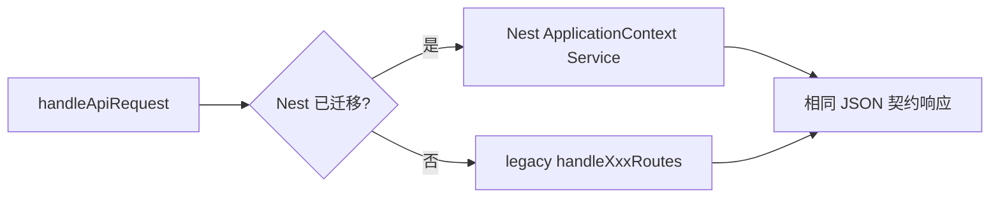

# NestJS 模块化迁移计划（B-13 ~ B-15）

> **目标：** 在不破坏现有 HTTP 路由契约的前提下，将 `apps/api` 从单体 `app.ts` 路由分发，逐步迁移为 NestJS `module / controller / guard` 结构。  
> **原则：** 绞杀者模式（Strangler Fig）；每迁移一个模块必须补回归测试；`handleApiRequest` 与 Console BFF 契约保持不变。

---

## 1. 现状

| 组件 | 位置 | 说明 |
|------|------|------|
| HTTP 入口 | `src/app.ts` → `handleApiRequest` | 手写 `matchPath` 路由表 |
| 运行时 DI | `src/runtime.ts` → `getRuntime()` | 全局单例，聚合 Auth / Documents / RAG / Chat |
| 鉴权 | `auth/auth.context.ts` → `requireAuthContext` | Bearer + `x-workspace-id` |
| 健康检查 | `health/health.service.ts` | B-09 已抽离 |
| 测试 | `app.test.ts` + 单元测试 | 依赖 `handleApiRequest`，**不得破坏** |

**未使用 NestJS。** 无 `@Controller` / `@Module` / Guard 体系。

---

## 2. 目标架构

```
src/nest/
  app.module.ts
  bootstrap.ts              # ApplicationContext（无独立 HTTP 端口）
  runtime/
    runtime.module.ts       # 提供 ApiRuntime / getRuntime 桥接
  health/
    health.module.ts
    health.controller.ts
    health.service.ts
  auth/                       # B-14
    auth.module.ts
    auth-route.service.ts
    workspace-route.service.ts
    guards/workspace.guard.ts
  routing/
    routing.module.ts
    nest-route.dispatcher.ts
  documents/                  # B-15
    documents.module.ts
    documents-route.service.ts
  rag/
    rag.module.ts
    rag-route.service.ts
  chat/
    chat.module.ts
    chat-route.service.ts
  analytics/
    analytics.module.ts
    analytics-route.service.ts
```

**过渡期请求流：**



最终阶段（B-16 已完成）：`NestFactory.create` + Express 适配器承载 HTTP；`handleApiRequest` 保留供测试与 catch-all 委托。

---

## 3. 分阶段任务

### B-13（本 Task）— 骨架 + Health 模块

- [x] 迁移计划文档（本文）
- [x] 安装 `@nestjs/common` / `@nestjs/core` / `reflect-metadata`
- [x] `AppModule` + `RuntimeModule` + `HealthModule`
- [x] `bootstrap.ts`：`createApplicationContext`（不新开端口）
- [x] `/health` 改由 `NestHealthService` 提供（`app.ts` 委托）
- [x] `health.controller.test.ts` 回归测试
- [ ] 其余路由仍走 legacy

**验收：** `GET /health` 响应字段与 B-09 一致；`app.test.ts` 全绿；`pnpm test` 通过。

### B-14 — 鉴权 / 工作区 Guard 模块化

- 抽取 `AuthGuard`（Bearer 校验）与 `WorkspaceGuard`（`x-workspace-id` + membership）
- `RequestContext` 通过 `@Req()` 或自定义 decorator 注入 Controller
- 先迁移 **只读** 路由：`GET /knowledge-bases`、`GET /document-jobs/dead-letter`
- `requireAuthContext` 保留，Guard 内部复用 `authApi.authenticate`

### B-15 — 业务模块拆分

| 模块 | 路由前缀 | 依赖 |
|------|----------|------|
| DocumentsModule | `/knowledge-bases`, `/documents`, `/document-jobs` | DocumentApi, queue |
| RagModule | `/bots` | RagService |
| ChatModule | `/conversations`, `/leads`, `/sites`, `/public/*` | ChatService, SSE |
| AnalyticsModule | `/dashboard`, `/reports` | 分析聚合 |

每模块迁移后：
1. 删除 `app.ts` 中对应 `handleXxxRoutes` 分支
2. 增加 `*.route.service.test.ts` 或扩展 `app.test.ts`
3. 更新本文档 checklist

**已完成：** `NestRouteDispatcher` + 六模块 RouteService；`handleApiRequest` 在 `http/handle-api-request.ts`；生产入口 `main.ts` → Nest Express。

### B-16 — Express HTTP 入口

- [x] `@nestjs/platform-express` + `express`
- [x] `NestFactory.create(AppModule, { bodyParser: false })`
- [x] `ApiHttpController` `@All('*')` 委托 `handleApiRequest`
- [x] `ApiPrefixMiddleware` 剥离 `/api/v1` 前缀
- [x] `GET /health` 仍可由 `HealthController` 直接响应
- [x] `app.test.ts` 继续直接调用 `handleApiRequest`（契约不变）

---

## 4. 路由契约冻结清单（不可改名）

| 方法 | 路径 | 迁移批次 |
|------|------|----------|
| GET | `/health` | B-13 |
| POST | `/auth/*` | B-14 |
| GET/PATCH | `/workspaces/*` | B-14 |
| GET/POST/PATCH/DELETE | `/knowledge-bases/*` | B-15 |
| GET/POST/DELETE | `/document-jobs/dead-letter*` | B-15 |
| GET/PATCH | `/bots/*` | B-15 |
| GET/PATCH | `/conversations/*` | B-15 |
| POST | `/public/chat/stream` (SSE) | B-15 末 |

`/api/v1` 前缀继续由 `normalizePath` 剥离，Nest Controller 使用无前缀路径。

---

## 5. 测试策略

| 层级 | 工具 | 覆盖 |
|------|------|------|
| Nest 模块 | `@nestjs/testing` + `node:test` | Controller / Service 契约 |
| HTTP 回归 | `handleApiRequest` in `app.test.ts` | 端到端路由 + 鉴权 |
| 集成 | `integration/platform-integration.test.ts` | RAG / DLQ / Health 栈 |

每个 Task 完成后运行：

```powershell
node node_modules/typescript/lib/tsc.js --noEmit -p apps/api/tsconfig.json
cd apps/api && pnpm test
```

---

## 6. 风险与规避

| 风险 | 规避 |
|------|------|
| 双份路由逻辑 | 已迁移路由必须从 `app.ts` 删除或仅委托 Nest Service |
| SSE / multipart | B-15 前保持 legacy；Nest 使用 `@Sse()` / 自定义 interceptor |
| `getRuntime()` 全局状态 | `RuntimeModule` 统一封装；测试调用 `resetNestContextForTests` |
| 包体积 | 仅 `apps/api` 引入 Nest；Console 不依赖 |

---

## 7. 进度追踪

| Task | 状态 | 说明 |
|------|------|------|
| B-13 | 已完成 | Health 模块 + ApplicationContext 桥接 |
| B-14 | 已完成 | Auth/Workspace Guard + AuthRouteService / WorkspaceRouteService |
| B-15 | 已完成 | Documents / RAG / Chat / Analytics 全量模块 + NestRouteDispatcher |
| B-16 | 已完成 | NestFactory + Express；ApiHttpController catch-all |
