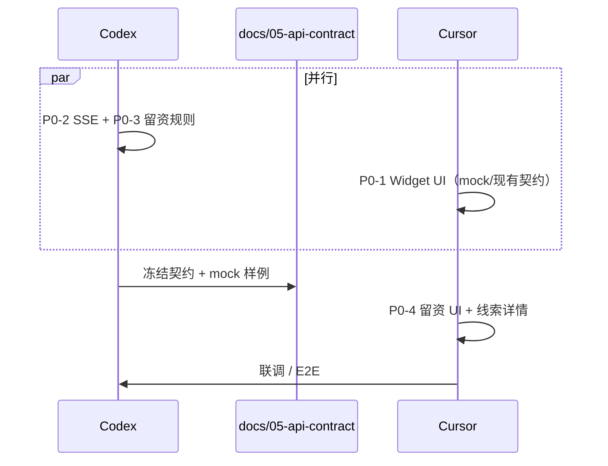

# P0 协作任务书（Codex × Cursor）

> **最高优先级护栏**：[AI云_项目核心需求护栏与开发防跑偏规则_V1.0.md](./AI云_项目核心需求护栏与开发防跑偏规则_V1.0.md)  
> 依据：[AI云_工业官网获客系统_核心项目书_V1.0.docx](./AI云_工业官网获客系统_核心项目书_V1.0.docx)  
> 接口基准：[05-api-contract.md](./05-api-contract.md)  
> 任务说明模板：护栏 §3 → 实例见 [tasks/P0-1-widget-ui.md](./tasks/P0-1-widget-ui.md)  
> 暂缓需求：[BACKLOG.md](./BACKLOG.md)  
> 分工红线：同一 Task ID 只允许一个主负责人改核心文件；跨端先 Codex 定契约 + mock，再 Cursor 接入。

---

## 当前并行安排（2026-07）

| Task | 负责人 | 状态 | 说明 |
|------|--------|------|------|
| **P0-1** 官网 Widget UI | **Cursor** | 进行中 | `apps/widget` 嵌入脚本、聊天窗、流式展示、来源引用、移动端、加载/失败态 |
| **P0-2** Public Chat + Widget SSE | **Cursor（代 Codex）** | 已完成核心项 | 错误码、SSE error、429 retryAfterSec、visitor 会话绑定 |
| **P0-3** 工业留资规则与线索摘要 | **Cursor（代 Codex）** | 已完成核心项 | 高意向关键词、字段校验、线索 summary/keyQuestion |
| **P0-4** Widget 留资 UI + 线索详情 | **Cursor** | 已完成 | Widget 留资表单 + Console 摘要/来源站点 |

---

## Codex — P0-2 Public Chat + Widget SSE

**范围（`apps/api`、`apps/worker`）**

1. `POST /public/chat/stream` 生产级 SSE（`meta` / `token` / `citations` / `done` / `error`）
2. Site Key + 域名白名单校验（`DOMAIN_NOT_ALLOWED` / `BOT_DISABLED`）
3. 访客 `visitorId`、会话 `conversationId` 持久化与恢复
4. IP / 站点级限流（`RATE_LIMITED` + `retryAfterSec`）
5. 上游 LLM / RAG 失败时的可读降级（不 500 裸奔）
6. `GET /public/widget.js` 静态资源与 embed 文档对齐
7. 单测 + 集成测试覆盖 SSE 事件顺序与错误码

**交付物**

- 更新 `docs/05-api-contract.md`（事件字段、错误码、示例 curl）
- PR 附：本地验证命令、SSE 抓包示例、与现有 `apps/api/src/app.test.ts` 对齐说明

**Cursor 依赖**

- P0-1 Widget 已按契约消费 SSE；若字段变更需同步 `apps/widget/src/lib/sse-client.ts`

---

## Codex — P0-3 工业留资规则与线索摘要

**范围**

1. 高意向语义识别：报价、询价、定制、非标、图纸、交期、采购、合同、电话、微信、邮箱等 → 优先引导留资
2. `done.needsLeadCapture` + `done.leadFields` 工业字段集（姓名/电话或邮箱/公司/需求描述 + 可选：产品类型、使用环境、尺寸、数量、图纸附件）
3. `POST /public/leads` 校验与 workspace 隔离
4. 线索创建：来源站点、会话 ID、关键问题、AI 摘要、状态、负责人占位
5. 会话摘要写入（供控制台线索/会话详情读取）

**交付物**

- 契约补充：`docs/05-api-contract.md` 中 leads / leadFields / summary 字段
- migration（如需要）+ 单测
- Mock 响应样例供 Cursor P0-4 联调

**Cursor 依赖（P0-4 启动条件）**

- [ ] `POST /public/leads` 请求/响应冻结
- [ ] `done.leadFields` 字段列表与校验规则文档化
- [ ] 线索摘要 API 或会话详情字段可供控制台只读

---

## Cursor — P0-1 官网 Widget UI（当前）

**范围（`apps/widget`）**

1. `<script data-bot-id data-site-key>` 嵌入，Shadow DOM 隔离样式
2. 悬浮入口 + 聊天面板（工业 B2B 视觉，移动端适配）
3. SSE 流式回复、来源引用展示、重新生成
4. 加载中 / 网络错误 / 403 域名未授权 / 429 限流 等状态
5. **不含**完整工业留资表单（留给 P0-4）

**验收**

- `pnpm --filter qiyun-widget build` 产出 `dist/widget.js` 并同步至 `apps/api/assets/widget.js`
- 本地 `index.html` 可打开预览
- 单测：`sse-client`、`config` 解析

---

## Cursor — P0-4 Widget 留资 UI + 线索详情（待 Codex 契约）

**前置条件**：P0-2 SSE 稳定 + P0-3 留资/摘要契约 PR 合并

**范围**

- Widget：`needsLeadCapture` 工业留资表单、提交反馈、与 SSE `done` 联动
- Console：线索详情展示 AI 摘要、来源站点、关键字段（`apps/console` 线索/会话页）

---

## 协作流程



---

## 验证命令（全员）

```bash
pnpm lint
pnpm typecheck
pnpm test
pnpm build
# Widget 本地预览
pnpm --filter qiyun-widget dev
pnpm --filter qiyun-widget build
```

## 开工检查（护栏 §11）

每个 Task 开工前，AI 必须先阅读护栏 + 对应 `docs/tasks/*.md`，并输出 7 项开工清单（见护栏文档），**未输出不得写代码**。
